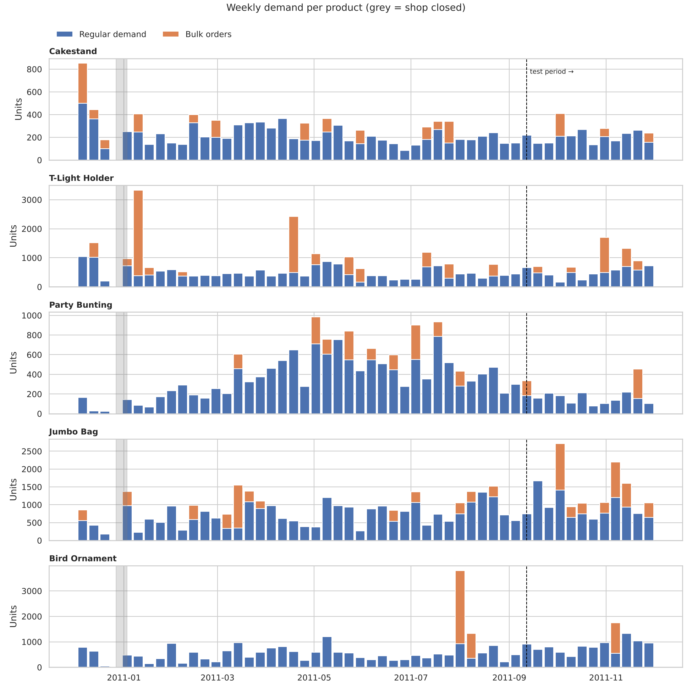
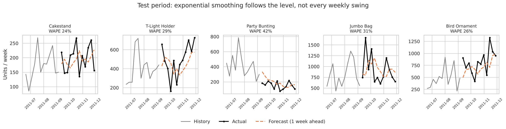
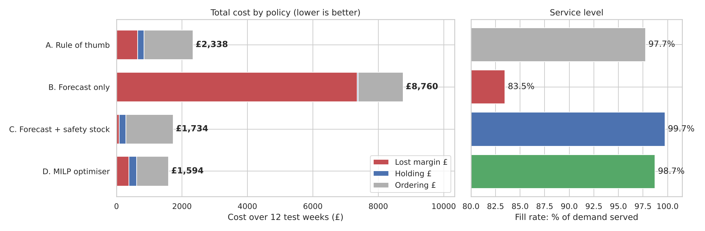
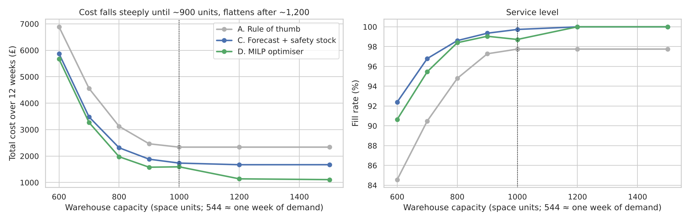

# Demand Forecasting & Inventory Optimisation

**How much of each product should a retailer order every week, with limited warehouse space and uncertain demand?**

This project forecasts weekly demand for 5 top-selling products of a real UK online retailer, measures how wrong those forecasts are, and feeds that uncertainty into a **mixed-integer linear programme** that plans orders under warehouse, budget and ordering-cost constraints. The policies are then **simulated on 12 weeks of real demand**.

  

---

## Key findings

| | |
|---|---|
| 📦 **The optimiser cuts inventory cost by ~1/3** | **−32%** total cost vs the rule of thumb "order what you sold" (−27% on validation weeks), and **−8%** vs textbook safety stock |
| 🎯 **A forecast alone isn't enough** | Ordering exactly the forecast loses **1 in 6 units** of demand (fill rate 83.5%) |
| ⚖️ **Theory says ~99.5% availability** | A lost sale costs ~208× more than holding a unit for a week. The real constraint is **warehouse space** |
| 🏭 **Warehouse space has diminishing returns** | 700 → 900 space units halves the cost; beyond ~1,200 there's no further gain |
| 🔁 **Simple forecasting wins again** | Exponential smoothing beat Holt and a pooled ridge regression; it's 6–7 points more accurate than the naive forecast |
| 🧾 **1% of order lines = 12–31% of units** | Bulk wholesale orders are unforecastable, so the recommendation is to handle them as **advance orders** |

---

## Business problem

The retailer (the same company as my [customer segmentation project](https://github.com/MOOZYYYY/customer-segmentation)) sells gifts online, mostly to wholesalers.
Ordering too little loses sales; ordering too much ties up cash and warehouse space; every order has a fixed admin and delivery cost.
**Goal:** a weekly ordering policy for the top products that minimises total cost (lost margin + holding + ordering) within a shared warehouse and budget.

## Data

[UCI Online Retail](https://archive.ics.uci.edu/dataset/352/online+retail): 541,909 real transactions, Dec 2010 to Dec 2011.
Five products were selected: the highest-revenue items selling on 280+ of ~305 trading days (Regency Cakestand, White Hanging Heart T-Light Holder, Party Bunting, Jumbo Bag Red Retrospot, Assorted Colour Bird Ornament), together **£532k** of revenue.

## Approach

| Notebook | What it does |
|---|---|
| [`01_demand_preparation`](notebooks/01_demand_preparation.ipynb) | Weekly demand, trading days (Saturdays, Christmas, bank holidays incl. the 2011 royal wedding), split into **regular** vs **bulk** demand |
| [`02_forecasting`](notebooks/02_forecasting.ipynb) | Rolling-origin back-test of 6 models (weeks 21–40 validation, 41–52 test), horizons 1–4, forecast-error measurement |
| [`03_inventory_optimisation`](notebooks/03_inventory_optimisation.ipynb) | Newsvendor analysis, **MILP** with expected lost sales, simulation of 4 policies on real demand, warehouse-capacity sensitivity |

---

## 1. Demand: regular vs bulk

<p align="center"></p>

About **1% of order lines carry 12–31% of units** (orange). These one-off wholesale orders can't be forecast, so the plan covers **regular demand** (blue), and bulk orders are recommended to be taken in advance.

## 2. Forecasting

| Model (1 week ahead) | Validation WAPE | Test WAPE |
|---|---|---|
| Naive (last week) | 38.4% | 36.5% |
| Moving average, 4 weeks | 33.1% | 31.3% |
| **Exponential smoothing (α = 0.4)** ✅ | **32.2%** | **29.3%** |
| Holt, damped trend | 35.1% | 30.3% |
| Ridge regression (pooled) | 32.9% | 32.0% |

Forecasts are made per trading day, so bank-holiday weeks aren't mistaken for weak demand. A ~30% error is normal for weekly single-product demand; the per-product error spread is measured and passed on to the optimiser.

<p align="center"></p>

## 3. Inventory optimisation

**Model:** every week, a mixed-integer programme (solved with HiGHS via SciPy) plans orders for all 5 products **4 weeks ahead**:

- **minimise** holding cost + lost margin × *expected* lost sales + £25 per order placed
- expected lost sales come from the forecast uncertainty: the convex loss function is approximated with tangent lines, so the model **chooses its own safety stock**
- subject to **warehouse space**, a **weekly budget**, and binary order decisions; only week 1 is executed (rolling horizon)

**Simulation on 12 real test weeks (Sep–Dec 2011):**

<p align="center"></p>

| Policy | Total cost | Fill rate | Orders |
|---|---|---|---|
| A. Rule of thumb: order what you sold | £2,338 | 98.4% | 60 |
| B. Forecast only, no buffer | £8,760 | 83.5% | 55 |
| C. Forecast + newsvendor safety stock | £1,734 | 99.7% | 58 |
| **D. MILP optimiser** | **£1,594** | 98.7% | **39** |

The optimiser's main advantage is **fewer, smarter orders**: it batches cheap, compact items instead of ordering every product every week. It was also the cheapest policy on the validation weeks and at every warehouse size tested.

### How much warehouse space is worth having?

<p align="center"></p>

---

## Recommendations

1. **Replace "order what you sold" with forecast-driven, optimised ordering.** It cuts inventory cost by about a third at similar service.
2. **Never order exactly the forecast.** Always plan for its error; without a buffer, 1 in 6 units of demand is lost.
3. **Take bulk wholesale orders in advance** instead of trying to stock for them.
4. **Warehouse space:** ~900 units is clearly worth it; ~1,200 only if the extra space costs less than ~£2,000/year for these products.
5. **Batch orders for cheap, compact items**: the fixed order cost matters more than their holding cost.

## Limitations

- Costs (50% margin, 25% annual holding, £25 per order, space per unit) are **assumptions**; the method stays the same with real figures.
- **One year of data**: seasonality is visible but can't be learned from a single cycle.
- **12 test weeks**: £ differences carry uncertainty, but the ranking held on validation weeks and across all capacities.
- Deliveries are assumed to arrive within the week ordered; forecast errors are assumed roughly normal (they're slightly right-skewed).

---

## How to run

```bash
git clone https://github.com/MOOZYYYY/demand-forecasting.git
cd demand-forecasting
pip install -r requirements.txt
curl -L -o data/online_retail.csv https://raw.githubusercontent.com/databricks/Spark-The-Definitive-Guide/master/data/retail-data/all/online-retail-dataset.csv
jupyter notebook notebooks/
```

Run the notebooks in order (01 → 02 → 03).

## Project structure

```
├── data/                  # raw + processed data (not tracked; see How to run)
├── notebooks/
│   ├── 01_demand_preparation.ipynb
│   ├── 02_forecasting.ipynb
│   └── 03_inventory_optimisation.ipynb
├── reports/figures/       # charts used in this README
└── requirements.txt
```
